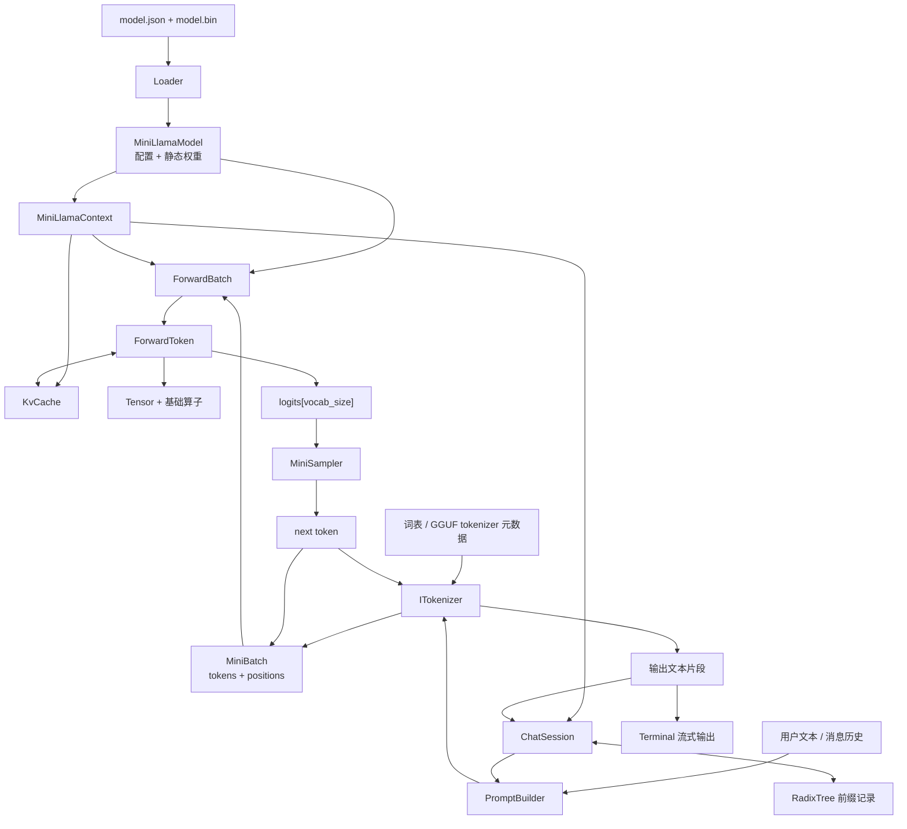
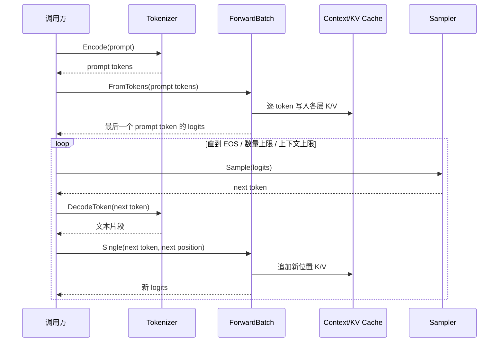
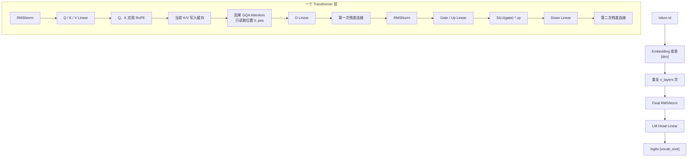

# 模块复习：从模型文件到文本生成

复习 mini-llama 第一个大模块的整体设计。这个大模块完成的是一条教学版、CPU F32 的 Llama 推理主链路：

```text
模型文件 / 词表
      ↓
模型与分词器对象
      ↓
Prompt 构建与 Tokenize
      ↓
Prefill / Decode 前向计算
      ↓
Logits 采样
      ↓
Token 解码与文本输出
```

它已经具备单轮生成和多轮聊天所需的核心组件，但目前仍是一个核心库，而不是完整的最终产品：仓库没有进程级 `main()`，模型加载、分词器创建和 `Run()` 之间仍需要上层调用方做最后的装配。

## 1. 先记住全局分层

从下往上看，整个模块可以分成六层：

| 层次 | 主要模块 | 核心职责 |
| --- | --- | --- |
| 数值基础层 | `Tensor`、`ops`、`matmul_dispatch` | 保存 F32 数据，完成矩阵乘法、归一化、激活、RoPE 等基础计算 |
| 模型资源层 | `model`、`loader`、`tokenizer` | 描述并加载模型权重，把文本与 token ID 相互转换 |
| 推理状态层 | `MiniLlamaContext`、`KvCache`、`MiniBatch` | 保存一次推理的动态状态，组织 prefill/decode 输入 |
| Transformer 计算层 | `forward` | 把输入 token 逐层变换为下一 token 的 logits |
| 生成策略层 | `sampler` | 根据 logits 选择下一个 token |
| 应用编排层 | `PromptBuilder`、`ChatSession`、`Terminal`、`main.cc` | 拼接对话、驱动生成循环、管理多轮状态并输出文本 |

辅助模块 `RadixTree` 用于记录已计算的 token 前缀，`RequestContext` 用于请求级追踪。前者已经接入聊天前缀复用，后者目前还是独立能力，尚未接入 `Run()` 主链路。

## 2. 模块关系总图



图中最关键的闭环是：

```text
logits → 采样 token → 把 token 再送入 ForwardBatch → 新 logits
```

模型每次前向计算输出的不是完整回答，而是“下一个 token 的分数”。因此生成 N 个 token，本质上是在重复执行这个闭环。

## 3. 每个模块具体做什么

### 3.1 Tensor 与基础算子

相关文件：

- `include/mini_llama/tensor.h`、`src/tensor.cc`
- `include/mini_llama/ops.h`、`src/ops.cc`
- `include/mini_llama/matmul_dispatch.h`、`src/matmul_optimized.cc`

`Tensor` 是整个系统的统一数据容器，当前只保存连续的 F32 数据：

```text
shape：张量各维长度
data ：按行优先连续存放的 float
```

它提供索引、行指针、shape 检查和安全 reshape。上层模块几乎不直接管理裸内存，而是通过 `Tensor` 传递权重、隐藏状态、Q/K/V、注意力分数和 logits。

基础算子负责 Transformer 中真正的数值计算：

| 算子 | 在模型中的用途 |
| --- | --- |
| `Matmul` / `Linear` | Q/K/V/O、FFN 和 LM Head 投影 |
| `RmsNorm` | 注意力前、FFN 前和模型末尾归一化 |
| `Softmax` | 把注意力分数归一化为概率 |
| `Silu` / `SwiGlu` | FFN 门控激活 |
| `Rope` | 给 Q、K 注入位置信息 |
| `ArgMax` | 贪心采样选择最大 logit |

`MatmulDispatch` 暴露了朴素、线程、SIMD、线程 SIMD 四种模式入口，但当前默认仍是朴素 CPU 实现。因此“dispatch 已存在”不等于“高性能后端已经完成”。

### 3.2 模型结构与模型加载器

相关文件：

- `include/mini_llama/model.h`
- `include/mini_llama/loader.h`、`src/loader.cc`

这里需要区分三个概念：

| 对象 | 含义 |
| --- | --- |
| `ModelConfig` | 模型结构参数，例如维度、层数、头数和上下文长度 |
| `LayerWeights` | 某一 Transformer 层的 Attention 与 FFN 权重 |
| `MiniLlamaModel` | 配置、所有层权重、Embedding、Final Norm 和 LM Head 的集合 |

`MiniLlamaModel` 是只读的静态资源。它不保存“当前生成到哪儿”，所以同一模型理论上可以被多个独立的 `MiniLlamaContext` 使用。

当前自定义模型格式由两个文件组成：

```text
model.json：配置、tokenizer 描述、每个张量的名称/shape/dtype/offset/byte_size
model.bin ：按清单偏移连续存放的 F32 权重
```

加载流程分两步：

1. `ParseManifest()` 解析并校验 `model.json`，生成 `ModelManifest`。
2. `LoadModel()` 按名称和偏移读取 `model.bin`，组装 `MiniLlamaModel`。

清单校验包括：模型维度关系、RoPE 参数、F32 字节数、张量名称唯一性、二进制区间不重叠、必需张量是否存在，以及每个张量 shape 是否符合模型配置。

两个入口的失败语义不同：

- `ParseManifest()` 遇到非法清单时抛出异常。
- `LoadModel()` 捕获错误并返回 `loaded == false`、带 `load_error` 的模型。

`InspectModel()` 只解析和打印清单，不读取权重文件，适合先检查模型元数据。

### 3.3 Tokenizer

相关文件：

- `include/mini_llama/tokenizer.h`
- `include/mini_llama/gguf_tokenizer.h`
- `src/tokenizer.cc`、`src/json_vocab_tokenizer.cc`
- `src/bpe_tokenizer.cc`、`src/gguf_tokenizer.cc`

所有分词器实现统一遵守 `ITokenizer` 接口：

```text
Encode(text)          文本 → token IDs
DecodeToken(token)   单个 token ID → 文本片段
Decode(tokens)       token IDs → 文本
bos_id/eos_id/unk_id 特殊 token
```

当前实现包括：

| 实现 | 用途 |
| --- | --- |
| `AsciiTokenizer` | 最简单的字符级教学/回退分词器 |
| `JsonVocabTokenizer` | JSON 词表，最长优先匹配，UTF-8 未知字符回退 |
| `BpeTokenizer` | 独立 vocab、merges、special token 文件的 GPT-2 风格 BPE |
| `GgufTokenizer` | 从 GGUF 元数据中读取词表与合并规则 |

Tokenizer 只负责文本和 token 的转换，不参与 Transformer 数值计算。模型与 tokenizer 的连接点是词表空间：Tokenizer 产生的 ID 必须能落入模型的 `[0, vocab_size)` 范围。

要特别注意：加载器读取 `model.json` 中的 `TokenizerInfo`，但不会自动创建 `ITokenizer`。上层仍需根据 `type/path` 调用合适的 tokenizer 构造或工厂函数。

### 3.4 MiniLlamaContext、KV Cache 与 MiniBatch

相关文件：

- `include/mini_llama/context.h`、`src/context.cc`
- `include/mini_llama/kv_cache.h`、`src/kv_cache.cc`
- `include/mini_llama/batch.h`、`src/batch.cc`

`MiniLlamaContext` 是一次推理会话的动态状态，核心内容包括：

```text
model         指向当前模型
kv_cache      已计算 token 在各层产生的 K/V
pos           当前正在计算的位置
token_history 已经真正送入前向计算的 token
```

模型是“知识和参数”，Context 是“这次生成已经走到哪里”。清空会话不能只删消息，还必须重建或清空 Context，否则旧 KV Cache 会污染新会话。

`KvCache` 的形状是：

```text
keys   [n_layers, max_seq_len, n_kv_heads, head_dim]
values [n_layers, max_seq_len, n_kv_heads, head_dim]
```

每处理一个 token，每层都会写入当前位置的 K/V。后续 token 计算注意力时直接读取历史缓存，不必重新计算所有旧 token 的 K/V。

`MiniBatch` 只是一组 token 与位置：

- `FromTokens(tokens, start_pos)` 用于 prompt prefill。
- `Single(token, pos)` 用于逐 token decode。

当前实现虽然叫 Batch，但内部仍按顺序逐 token 调用 `ForwardToken()`，还不是真正并行的批计算。

### 3.5 Forward：Transformer 前向计算

相关文件：

- `include/mini_llama/forward.h`
- `src/forward.cc`

这里有两个入口：

```text
ForwardBatch  管理一组 token 的位置、历史，并返回最后一个 token 的 logits
ForwardToken  对当前位置的单个 token 执行完整 Transformer 前向
```

`ForwardBatch()` 在每一步先设置 `ctx.pos`，再调用 `ForwardToken()`，最后把该 token 追加到 `ctx.token_history`。这样 prefill 和 decode 可以复用同一条计算路径：

```text
Prefill = ForwardBatch(多个 prompt token)
Decode  = ForwardBatch(一个刚生成的 token)
```

单个 token 在 `ForwardToken()` 内部的完整路径见第 5 节。

### 3.6 Sampler

相关文件：

- `include/mini_llama/sampler.h`
- `src/sampler.cc`

`MiniSampler` 把 `[vocab_size]` logits 变成一个 token ID。`SamplingParams` 保存三个参数：

| 参数 | 作用 |
| --- | --- |
| `temperature` | 控制随机性；接近 0 时为贪心 |
| `top_k` | 只在分数最高的 K 个候选中采样；0 表示关闭 |
| `seed` | 非 0 时让随机采样可复现 |

统一入口 `Sample()` 的分发规则是：

```text
temperature < 1e-6 或 top_k == 1 → Greedy
top_k > 1                            → Top-k 后按温度采样
其他                                 → 全词表温度采样
```

Sampler 不知道文本、上下文或 EOS 的含义。EOS 判断由上层生成循环在拿到 token 后完成。

### 3.7 PromptBuilder、ChatSession 与 Terminal

相关文件：

- `include/mini_llama/prompt_builder.h`、`src/prompt_builder.cc`
- `include/mini_llama/chat.h`、`src/chat.cc`
- `include/mini_llama/terminal.h`、`src/terminal.cc`
- `include/mini_llama/radix_tree.h`、`src/radix_tree.cc`

`PromptBuilder` 把结构化消息历史转成模型实际看到的一段文本：

```text
[{role: user, content: ...}, {role: assistant, content: ...}]
                              ↓
                   一段带角色标记的 prompt
```

它支持 Plain 格式、内置 Qwen2 格式和轻量 Jinja2 子集。它只处理“消息如何排列成文本”，不负责 tokenize。

`ChatSession` 保存：

- 逻辑消息历史 `messages`；
- 最近已计算的 token 历史 `token_history`；
- 已完成前向计算的前缀树 `prefix_cache`；
- 采样参数与累计统计。

`RadixTree` 只回答“某个 token 序列在已登记序列中有多长的公共前缀”。真正的 K/V 数据仍在当前 `MiniLlamaContext::kv_cache` 中。因此前缀树不是 KV Cache，也不能单独恢复一次推理状态。

`Terminal` 只封装输入输出、提示符、流式 token 输出及 `/help`、`/stats` 等显示行为，使交互代码可以注入字符串流进行测试。

### 3.8 Run、Generate 与辅助追踪

相关文件：

- `src/main.cc`
- `include/mini_llama/request_context.h`、`src/request_context.cc`

`src/main.cc` 是当前大模块的编排中心：

- `Generate()` 执行一次性文本生成。
- `Run()` 解析 `generate` / `run` 模式和采样参数。
- `RunInteractive()` 驱动多轮输入。
- `RunChatTurn()` 完成一轮聊天的 prompt、prefill、decode、输出和状态更新。

虽然文件名是 `main.cc`，它并没有定义全局 `main()`，也不加载模型。调用方必须先准备好 `MiniLlamaModel` 和 `ITokenizer`，再调用这里的入口。

`RequestContext` 可以记录模型加载、tokenize、prefill、decode、sample 等阶段耗时和事件，并格式化 trace。当前 `Generate()` / `Run()` 尚未使用它，所以它是已实现但未接线的辅助模块。

## 4. 第一个大模块的端到端执行流程

### 4.1 初始化阶段

完整应用在进入生成前，应完成以下步骤：

1. 通过 `ParseManifest(model.json)` 读取配置、tokenizer 描述和张量清单。
2. 通过 `LoadModel(model.json, model.bin)` 加载模型权重。
3. 检查 `model.loaded`；失败时读取 `model.load_error`，不能进入前向计算。
4. 根据 `manifest.tokenizer.type/path` 创建对应 `ITokenizer`。
5. 检查 tokenizer 词表与模型 `vocab_size` 是否兼容。
6. 选择 `generate` 或 `run` 模式，并准备采样参数。

当前这些步骤尚未由一个进程级入口自动串起，概念上的装配关系如下：

```cpp
ModelManifest manifest = ParseManifest(config_path);
MiniLlamaModel model = LoadModel(config_path, weights_path);
// 根据 manifest.tokenizer 创建 tokenizer
// 然后调用 Run(..., model, *tokenizer, ...)
```

### 4.2 单轮 Generate 流程

`Generate()` 的步骤如下：

1. 校验模型已经加载、生成长度和采样参数有效。
2. `tokenizer.Encode(prompt)` 把输入文本编码为 token。
3. 空 prompt 使用合法 BOS，非空 prompt 编码结果不能为空。
4. 创建全新的 `MiniLlamaContext`，同时按模型配置分配 KV Cache。
5. 用 `MiniBatch::FromTokens(tokens)` 构造 prefill 批次。
6. `ForwardBatch()` 顺序计算全部 prompt token，返回最后一个 prompt token 的 logits。
7. `sampler.Sample(logits)` 选择下一个 token。
8. 如果 token 是 EOS，立即结束。
9. `DecodeToken()` 把 token 转成文本并追加到结果。
10. 若还要继续生成，用 `MiniBatch::Single(token, ctx.pos + 1)` 把刚生成的 token 送回模型，得到下一轮 logits。
11. 重复步骤 7～10，直到 EOS、达到 `max_tokens` 或到达上下文长度限制。

对应的时序是：



### 4.3 Prefill 与 Decode 的关系

这是整条链路最容易混淆、也最值得记住的地方。

#### Prefill

Prefill 一次接收整段 prompt token，但当前实现内部仍按顺序处理：

```text
token[0] at pos 0 → 写 KV
token[1] at pos 1 → 读取 pos 0..1，写 KV
...
token[n] at pos n → 读取 pos 0..n，写 KV → 返回 logits
```

结束后，KV Cache 已包含 prompt 的上下文，返回的 logits 用于预测 prompt 后面的第一个 token。

#### Decode

采样得到 token 后，必须把它作为下一个位置的输入再前向一次：

```text
采样 token at pos n+1
        ↓
读取 prompt 和既有生成 token 的 KV
        ↓
写入这个 token 自己的 KV
        ↓
得到预测 pos n+2 的 logits
```

因此：

- logits 描述“下一个 token”的分数；
- KV Cache 保存“已经送入模型的 token”的 K/V；
- 单纯采样但不把 token 再送入模型，无法继续正确生成后续 token。

### 4.4 多轮 Run / Chat 流程

交互模式在单轮生成上增加了消息历史、命令和前缀复用。

每轮普通用户输入执行：

1. 复制历史消息，临时追加本轮 user 消息。
2. `PromptBuilder::Build()` 把完整候选消息构建成 prompt 文本。
3. Tokenizer 把完整 prompt 编码成新的 token 序列。
4. 同时查询 `RadixTree` 已登记前缀和当前 `context.token_history` 的公共前缀。
5. 取二者较小值，保证准备复用的前缀既“曾经计算过”，又“仍存在于当前 Context 的 KV Cache 中”。
6. 把 Context 回退到该前缀末端，只对未命中的后缀执行 prefill。
7. 从 prefill logits 开始逐 token 采样、解码、流式输出和 decode。
8. 把 user/assistant 消息写入 `ChatSession`。
9. 记录完整 token 历史、可复用前缀和本轮统计。

前缀复用的安全条件可概括为：

```text
安全复用长度 = min(前缀树命中长度, 当前 Context 真实公共前缀长度)
```

只看前缀树是不够的，因为它只证明这个前缀过去算过，不证明对应 K/V 仍在当前 Context；只看 token 历史也不够表达会话中登记过的可复用序列。两者结合后才允许复用。

特殊情况：如果新 prompt 与缓存 token 完全相同，代码会回退一个 token 并重算最后位置，以重新取得可用于采样的 logits。

交互命令不会进入模型：

| 命令 | 行为 |
| --- | --- |
| `/help` | 显示帮助 |
| `/stats` | 显示会话累计统计 |
| `/clear` | 同时清空消息、前缀、统计并重建 Context/KV Cache |
| `/exit` | 退出交互循环 |

## 5. 单个 token 在 Transformer 内部怎么执行

`ForwardToken(ctx, model, token)` 的内部流程是：



按步骤展开：

1. 校验模型、配置、token、位置、KV Cache 和所有权重 shape。
2. 从 `token_embedding[vocab_size, dim]` 复制 token 对应的一行，得到 `[dim]` 隐藏状态。
3. 对每层执行 Pre-Norm Attention：
   - RMSNorm；
   - Q/K/V 线性投影和可选 bias；
   - reshape 为多头结构；
   - 对 Q、K 应用 RoPE；
   - 把当前位置 K/V 写入 KV Cache；
   - Q 与位置 `0..pos` 的 K 做缩放点积；
   - Softmax 后对历史 V 加权求和；
   - O 投影并与层输入做残差连接。
4. 执行 Pre-Norm FFN：
   - RMSNorm；
   - Gate 与 Up 两路投影；
   - `Silu(gate) * up`；
   - Down 投影；
   - 与 Attention 残差结果再次相加。
5. 所有层结束后执行 Final RMSNorm。
6. 通过 LM Head 投影到 `[vocab_size]`，得到 logits。

GQA 的映射规则是：

```text
kv_head = query_head / (n_heads / n_kv_heads)
```

因此多个 Query Head 可以共享同一个 KV Head，从而减少 KV Cache 占用。

## 6. 关键数据的 shape 变化

假设模型配置为：

```text
V = vocab_size
D = dim = n_heads * head_dim
H = hidden_dim
QH = n_heads
KVH = n_kv_heads
HD = head_dim
```

单 token 前向中的主要 shape 为：

| 阶段 | Shape |
| --- | --- |
| Token embedding | `[D]` |
| Q 投影 | `[QH * HD]` → `[QH, HD]` |
| K/V 投影 | `[KVH * HD]` → `[KVH, HD]` |
| 单个 Query Head 的注意力分数 | `[pos + 1]` |
| 所有头的 Attention 输出 | `[QH, HD]` → `[1, D]` → `[D]` |
| Gate / Up | `[H]` |
| FFN Down 输出 | `[D]` |
| 最终 logits | `[V]` |
| KV Cache | `[n_layers, max_seq_len, KVH, HD]` |

模型权重统一使用 `[out_features, in_features]` 排列，`Linear(x, weight)` 的语义是 `x @ weight^T`。

## 7. 几组容易混淆的概念

### 模型与上下文

```text
MiniLlamaModel   静态、可复用：配置和权重
MiniLlamaContext 动态、会变化：位置、token 历史和 KV Cache
```

更换会话通常不需要重新加载模型，但必须创建新的 Context。

### KV Cache 与 RadixTree

```text
KV Cache   保存真正用于注意力计算的浮点 K/V
RadixTree  只保存哪些 token 前缀被登记过
```

RadixTree 不是 KV 数据仓库，不能脱离当前 Context 直接复用推理结果。

### PromptBuilder 与 Tokenizer

```text
PromptBuilder  消息结构 → prompt 文本
Tokenizer      prompt 文本 → token IDs
```

前者决定聊天格式，后者决定模型词表中的编码。

### Prefill 与 Decode

二者最终都调用 `ForwardBatch()`；区别只在输入数量和上下文所处阶段：

```text
Prefill：一次组织多个 prompt token
Decode ：一次组织一个刚生成的 token
```

### Logits 与概率

Forward 输出 logits，它们是未归一化分数。Sampler 根据温度和 Top-k 策略把这些分数转换成选择结果。模型前向本身不决定使用贪心还是随机生成。

## 8. 当前边界与尚未完全接通的地方

复习时要把“已经有组件”和“已经端到端自动接线”区分开：

- 当前是 CPU F32 教学实现，没有量化权重和 GPU 后端。
- `MiniBatch` 内部仍逐 token 执行，不是并行 batch 推理。
- `src/main.cc` 没有进程级 `main()`，项目目前构建的是核心库和测试。
- Loader 不会根据 `TokenizerInfo` 自动实例化 tokenizer。
- Loader 与 `Run()` 之间没有最终 CLI 装配层。
- GGUF 当前主要用于 tokenizer 元数据，模型权重加载走自定义 `model.json + model.bin`。
- `RequestContext` 已实现，但未接入 Generate/Run 的阶段计时。
- Context 中的 `n_prefill_tokens` / `n_decode_tokens` 字段目前没有在主流程更新。
- 聊天模板当前由 `PromptBuilder` 接收字符串，尚未自动从模型格式注入。
- 前缀复用只复用当前单个 Context 中仍存在的 KV Cache，没有跨请求 KV 快照池。

这些边界不影响理解第一大模块的主干：它已经建立了从已加载模型和 tokenizer 到 autoregressive 文本生成的完整计算闭环。

## 9. 建议的复习顺序

如果隔了一段时间，按下面顺序读代码最快：

1. `include/mini_llama/model.h`：先记住配置和所有权重 shape。
2. `include/mini_llama/context.h` 与 `include/mini_llama/kv_cache.h`：理解动态状态。
3. `src/batch.cc`：看 prefill/decode 如何统一到 `ForwardToken()`。
4. `src/forward.cc`：看一个 token 如何通过 Transformer。
5. `src/sampler.cc`：看 logits 如何变成 token。
6. `src/main.cc` 的 `Generate()`：看最小生成闭环。
7. `src/main.cc` 的 `RunChatTurn()`：看多轮聊天和前缀复用。
8. `src/prompt_builder.cc` 与 `src/chat.cc`：补齐消息格式和会话状态。
9. `src/loader.cc` 与各 tokenizer：最后回看输入资源如何变成可推理对象。

已有的阶段文档可用于深入某个子模块：

- `docs/tensor_ops_implementation.md`
- `docs/tokenizer_implementation.md`
- `docs/kv_cache_context_implementation.md`
- `docs/sampler_sampling_strategy_implementation.md`
- `docs/chat_prompt_run_implementation.md`

## 10. 一句话复述整个模块

可以用下面这句话检查自己是否已经重新掌握整体结构：

> Loader 把磁盘权重组装成只读 Model，Tokenizer 把 PromptBuilder 生成的文本变成 token；ForwardBatch 借助 Context 与 KV Cache 对 token 做 prefill/decode，ForwardToken 用 Tensor 和基础算子执行 Transformer 得到 logits；Sampler 选出新 token，再把它送回前向循环；ChatSession、RadixTree 和 Terminal 在外层维护多轮历史、前缀复用与流式输出。
