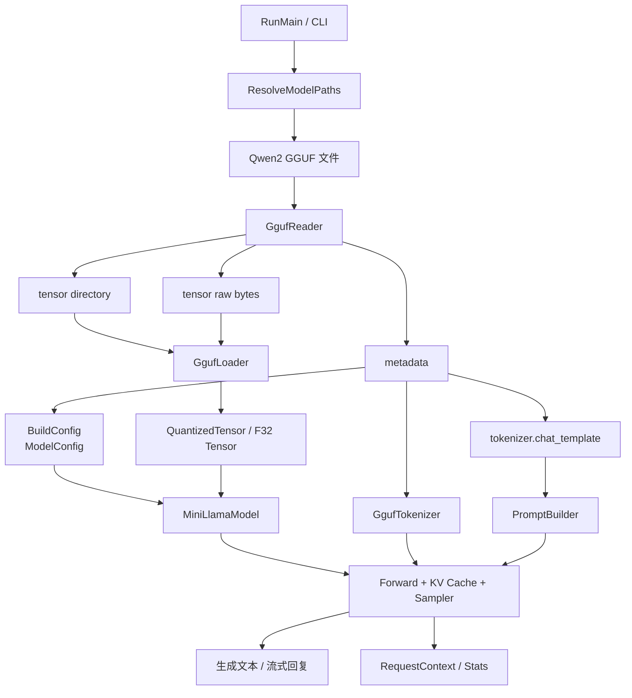
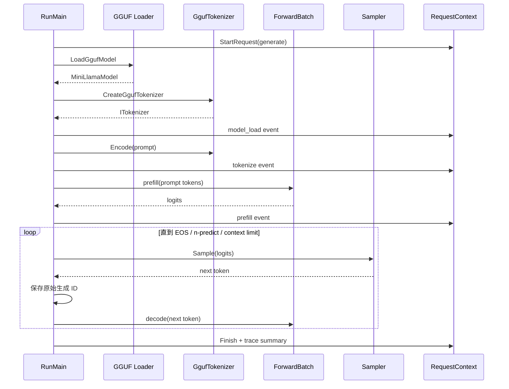

# 模块复习：从真实 GGUF 模型到端到端推理

> 当前完整模块清单见 [README](../README.md)，入口与构建状态见
> [CLI 同步说明](cli_integration_status.md)。本文中的阶段测试数字、真实模型输出
> 与计时是历史记录；当前实现与最新回归结果以 README 和 CLI 同步说明为准。

这份文档复习 mini-llama 第二个大模块：**真实模型接入**。

第一份复习文档 `docs/first_major_module_review.md` 解释了“一个已经装配好的
`MiniLlamaModel` 和 tokenizer 如何完成自回归生成”。当时最明显的缺口是：

```text
模型文件还没有自动变成可推理对象
Tokenizer、Chat Template 和模型还没有统一装配
仓库还没有真正可执行的进程级 CLI
RequestContext 还没有进入主链路
```

第二个大模块解决的正是这些问题。它把一份真实的 Qwen2 GGUF 文件拆成模型
配置、量化权重、tokenizer metadata 和 chat template，再把这些资源统一交给
第一大模块已经完成的 Forward、KV Cache、Sampler 和 Chat 主链路：

```text
真实 Qwen2 GGUF
      ↓
读取、校验和检查文件结构
      ↓
metadata → ModelConfig
tensor data → MiniLlamaModel
tokenizer metadata → GgufTokenizer
chat_template → PromptBuilder
      ↓
进程级 CLI 统一装配
      ↓
Generate / Run / Trace / Stats
```

最终使用的真实模型是：

```text
models/chat/Qwen2-0.5B-Instruct-Q8_0.gguf
大小：531065536 bytes
格式：GGUF v3
量化：Q8_0 为主，norm 和 bias 为 F32
```

本文重点是重新建立整体心智模型。各阶段的实现细节仍可回看：

- `docs/gguf_implementation.md`
- `docs/gguf_loader_branch_summary.md`
- `docs/gguf_tokenizer_integration_implementation.md`
- `docs/chat_prompt_run_implementation.md`
- `docs/qwen2_gguf_end_to_end_smoke_test.md`

## 1. 先记住这个模块到底新增了什么

第一大模块的输入可以抽象成：

```text
一个已加载的 Model + 一个可用的 Tokenizer
```

第二大模块把这个抽象输入变成了真正可从磁盘获得的资源：

| 能力 | 第一大模块结束时 | 第二大模块结束时 |
| --- | --- | --- |
| 模型来源 | 自定义 `model.json + model.bin`，或测试代码手工构造 | 直接加载真实 GGUF |
| 权重类型 | F32 为基础，量化算子是独立能力 | GGUF Q8_0/Q4_0/Q4_1 线性权重可直接执行 |
| 模型配置 | 清单或调用方提供 | 从 `<architecture>.*` metadata 动态映射 |
| Tokenizer | 调用方手工创建 | 默认从同一 GGUF metadata 创建 |
| Chat Template | 调用方注入 | 自动从 GGUF 读取并注入 |
| 进程入口 | 缺少完整最终装配 | 构建 `mini-llama` 可执行程序 |
| 模型检查 | 自定义 manifest 检查 | `inspect-gguf` 检查 metadata 和 tensors |
| 请求追踪 | `RequestContext` 独立存在 | `generate` 路径记录实际阶段和 token 数 |
| 真实验收 | tiny model / 单元测试 | Qwen2-0.5B-Instruct-Q8_0 端到端运行 |

一句话区分两个大模块：

> 第一大模块回答“模型如何算”，第二大模块回答“真实模型文件如何安全地变成可算、可聊、可观察的程序”。

## 2. 全局分层

真实模型接入可以分为七层：

| 层次 | 主要模块 | 核心职责 |
| --- | --- | --- |
| 文件格式层 | `gguf` | 解析 GGUF 头、metadata、tensor directory 和数据范围 |
| 权重表示层 | `quantized_tensor`、`quant` | 保存量化块，并执行量化 Linear |
| 模型映射层 | `gguf_loader`、`model` | metadata → 配置，GGUF tensor → 模型字段 |
| 分词资源层 | `gguf_tokenizer`、导出脚本 | 从同一 GGUF 得到词表、merges 和特殊 token |
| 对话格式层 | `PromptBuilder` | 执行 GGUF chat template，得到最终 prompt 文本 |
| 进程装配层 | `RunMain()`、`LoadModelAndTokenizer()` | 解析路径、选择资源、调用生成或交互入口 |
| 可观测层 | `RequestContext`、`Terminal` | trace、错误状态、会话统计和流式输出 |

第一大模块中的 Context、KV Cache、Forward、Sampler、ChatSession 和 RadixTree
仍然存在，并没有被第二套实现替换。第二大模块只是把真实资源接到这些稳定接口
上。

## 3. 模块关系总图



最需要记住的边界是：

```text
GgufReader     只理解文件结构
GgufLoader     只理解文件字段如何映射到模型对象
GgufTokenizer  只理解文本和 token ID
PromptBuilder  只理解消息如何变成 prompt 文本
RunMain        负责把这些独立资源装配到一起
Forward        不知道权重来自 GGUF 还是自定义格式
```

这种分层让真实模型接入没有侵入性地重写第一大模块。

## 4. GGUF 文件应该怎样理解

### 4.1 GGUF 的逻辑布局

当前读取器面向 GGUF v3。文件可以简化为：

```text
magic = "GGUF"
version
n_tensors
n_metadata

metadata key/value × n_metadata
tensor info        × n_tensors

padding 到 general.alignment（默认 32）

tensor data section
```

metadata 描述模型“是什么”，例如：

```text
general.architecture = qwen2
qwen2.embedding_length = 896
qwen2.block_count = 24
tokenizer.ggml.tokens = [...]
tokenizer.chat_template = "..."
```

tensor directory 描述权重“在哪里、是什么形状、是什么类型”：

```text
name
n_dims
shape[0..n_dims)
ggml_type
offset（相对于 tensor data section）
```

真正的权重字节位于数据段。Reader 先解析目录，Loader 再按需读取具体 tensor，
不会在第一次检查文件时无条件把全部权重读入内存。

### 4.2 `GgufReader` 保存什么

核心对象是：

```cpp
struct GgufReader {
  uint32_t version;
  uint64_t n_tensors;
  uint64_t n_metadata;
  std::vector<GgufMetadataKv> metadata;
  std::vector<GgufTensorInfo> tensors;
  uint64_t data_offset;
  std::string load_error;
};
```

`GgufMetadataKv::value_str` 是面向检查输出的摘要。标量保存可读文本，数组只保存：

```text
[元素数量 x 元素类型]
```

例如真实模型不会在 `GgufReader::metadata` 中复制并打印 151936 个 token，而是
显示：

```text
metadata tokenizer.ggml.tokens (array): [151936 x string]
```

需要完整值时使用类型化 getter 重新扫描 metadata：

```text
GgufGetMetadataInt
GgufGetMetadataFloat
GgufGetMetadataString
GgufGetMetadataStringArray
GgufGetMetadataIntArray
```

这是一种偏简单、偏安全的实现：Reader 的常驻目录结构较小，但多个 getter 会
多次重新打开并扫描文件。当前模型规模可以接受，未来若追求加载性能，可以考虑
建立一次性类型化 metadata 索引。

### 4.3 Reader 在信任文件前检查什么

`GgufReader::Load()` 会检查：

- magic 必须为 `GGUF`。
- version 必须是当前支持的 v3。
- tensor 和 metadata 数量不能超过安全上限。
- metadata key 不能重复。
- tensor name 不能重复。
- 字符串、数组、维度和计数必须能完整读取。
- tensor 维数必须有效，维度不能为零。
- `general.alignment` 必须是允许范围内的二次幂。
- 数据段起点、tensor offset、tensor size 的加法和乘法不能溢出。
- 已知布局 tensor 的数据范围不能越过文件末尾。

Reader 的错误约定是：

```text
成功：Load() == true，load_error 为空
失败：Load() == false，load_error 保存原因
```

底层 Reader 不直接打印错误。由 `inspect-gguf`、Loader 或 CLI 决定怎样向用户
展示。

### 4.4 已知类型与未知类型

当前 Reader 能计算以下 GGML 类型的物理大小：

| GGML 类型 | 每块逻辑元素 | 每块字节 |
| --- | ---: | ---: |
| F32 | 1 | 4 |
| F16 | 1 | 2 |
| Q8_0 | 32 | 34 |
| Q4_0 | 32 | 18 |
| Q4_1 | 32 | 20 |

未知类型可以保留在 tensor directory 中并由 `inspect-gguf` 显示为 UNKNOWN，但
Reader 无法可靠推导其字节布局，Loader 也不能把它作为当前模型的必需权重。

### 4.5 `inspect-gguf` 为什么很重要

`inspect-gguf` 只执行格式检查和目录展示，不需要创建模型、tokenizer 或 KV
Cache：

```bash
./build/mini-llama inspect-gguf MODEL.gguf
```

它首先回答以下问题：

```text
文件真的是 GGUF 吗？
版本受支持吗？
architecture 是什么？
模型维度和层数是否存在？
tokenizer metadata 是否嵌入？
chat template 是否存在？
需要的 tensor 名称、shape 和类型是否出现？
tensor 数据范围是否落在文件内？
```

如果 `inspect-gguf` 已经失败，就不应该直接进入更昂贵的模型加载和前向调试。

## 5. 从 GGUF metadata 构造 `ModelConfig`

### 5.1 architecture 决定 metadata 前缀

Loader 不把 Qwen2 的键名写死到每个字段，而是先读取：

```text
general.architecture
```

再构造：

```text
prefix = architecture + "."
```

因此 Qwen2 读取 `qwen2.*`，其他遵守相同 GGUF 通用命名约定的架构可以读取自己
的前缀。

字段映射如下：

| `ModelConfig` 字段 | GGUF metadata |
| --- | --- |
| `dim` | `<architecture>.embedding_length` |
| `hidden_dim` | `<architecture>.feed_forward_length` |
| `n_layers` | `<architecture>.block_count` |
| `n_heads` | `<architecture>.attention.head_count` |
| `n_kv_heads` | `<architecture>.attention.head_count_kv`，缺省时等于 `n_heads` |
| `max_seq_len` | `<architecture>.context_length` |
| `rope_theta` | `<architecture>.rope.freq_base`，缺省时保留模型默认值 |
| `rms_norm_eps` | `<architecture>.attention.layer_norm_rms_epsilon` |
| `head_dim` | `dim / n_heads` 推导 |
| `vocab_size` | 架构 metadata，缺省时从 embedding shape 推导 |

### 5.2 为什么不能接受 `dim=0` 或 `layers=0`

这些值不是“尚未初始化但可以继续”的状态。它们会直接破坏：

- Q/K/V shape 推导。
- KV Cache 分配。
- RoPE 头维度。
- 层权重装配循环。
- Forward 的 token 和位置检查。

因此必需字段使用 `RequiredPositiveInt()`：缺失、类型不匹配、非正或超过 `int`
范围都会使模型加载失败，而不是让默认零值流入后续计算。

### 5.3 配置之间还要满足关系约束

仅仅“每个字段大于零”还不够。Loader 继续检查：

```text
dim % n_heads == 0
n_heads % n_kv_heads == 0
head_dim = dim / n_heads
head_dim % 2 == 0
embedding.shape[1] == dim
embedding.shape[0] == vocab_size
```

这些约束分别对应多头 reshape、GQA 头共享、RoPE 二元旋转以及词表查表。

## 6. Qwen2 配置在当前项目中的具体含义

真实模型解析结果：

| 配置 | 值 |
| --- | ---: |
| `vocab_size` | 151936 |
| `dim` | 896 |
| `hidden_dim` | 4864 |
| `n_layers` | 24 |
| `n_heads` | 14 |
| `n_kv_heads` | 2 |
| `head_dim` | 64 |
| `max_seq_len` | 32768 |
| `rope_theta` | 1000000 |
| `rms_norm_eps` | 0.000001 |
| `rope_type` | `kNeoX` |

由这些值可以立即推出：

```text
query_dim = n_heads * head_dim = 14 * 64 = 896
kv_dim    = n_kv_heads * head_dim = 2 * 64 = 128
每个 KV head 被 14 / 2 = 7 个 query head 共享
```

所以单层主要权重的项目侧 shape 是：

| 权重 | 项目 shape |
| --- | --- |
| Q | `[896, 896]` |
| K | `[128, 896]` |
| V | `[128, 896]` |
| O | `[896, 896]` |
| Gate | `[4864, 896]` |
| Up | `[4864, 896]` |
| Down | `[896, 4864]` |
| Q bias | `[896]` |
| K/V bias | `[128]` |

如果把 K/V 错当成 14 个头，最先出现的通常不是文本质量问题，而是 shape 不匹配
或 KV Cache 越界。GQA 配置必须从 metadata 一路保持到 Loader、Forward 和
KV Cache。

## 7. GGUF shape 为什么要反转

GGUF shape 以 `ne0` 为最快变化维。例如 inspect 输出：

```text
token_embd.weight shape=[896,151936]
blk.0.attn_k.weight shape=[896,128]
```

项目内部使用行主序 `[out_features, in_features]`：

```text
GGUF [in_features, out_features]
                 ↓ 反转逻辑维度
项目 [out_features, in_features]
```

因此：

```text
token_embd.weight [896, 151936] → token_embedding [151936, 896]
attn_k.weight     [896, 128]    → wk              [128, 896]
```

这里不需要转置原始字节。GGUF 的最快变化维正好对应项目矩阵每行连续的输入维；
只需反转逻辑 shape，就能以 `[out, in]` 解释同一串数据。

这也是最容易出现“shape 看起来反了”的地方。复习时要区分：

```text
inspect 展示的是 GGUF ne 顺序
MiniLlamaModel 保存的是项目 Tensor 顺序
```

## 8. tensor 名称如何映射到模型字段

模型级映射：

| GGUF tensor | `MiniLlamaModel` |
| --- | --- |
| `token_embd.weight` | `token_embedding` |
| `output_norm.weight` | `final_norm` |
| `output.weight` | `lm_head` |

层级映射：

| GGUF tensor | `LayerWeights` |
| --- | --- |
| `blk.N.attn_norm.weight` | `layers[N].attention_norm` |
| `blk.N.attn_q.weight` | `layers[N].wq` |
| `blk.N.attn_k.weight` | `layers[N].wk` |
| `blk.N.attn_v.weight` | `layers[N].wv` |
| `blk.N.attn_q.bias` | `layers[N].bq` |
| `blk.N.attn_k.bias` | `layers[N].bk` |
| `blk.N.attn_v.bias` | `layers[N].bv` |
| `blk.N.attn_output.weight` | `layers[N].wo` |
| `blk.N.ffn_norm.weight` | `layers[N].ffn_norm` |
| `blk.N.ffn_gate.weight` | `layers[N].w_gate` |
| `blk.N.ffn_up.weight` | `layers[N].w_up` |
| `blk.N.ffn_down.weight` | `layers[N].w_down` |

层号必须是十进制数字。当前模型不认识的 GGUF 扩展 tensor 不会被猜测性地塞入
`LayerWeights`；只有映射表明确认识的名称才进入模型索引。

装配完成后，`ValidateLoadedShapes()` 再按照 Forward 的真实 shape 约定逐层检查。
只有所有必需权重存在且 shape 正确时，`model.loaded` 才会变为 `true`。

## 9. 稠密张量和量化线性权重为什么分开加载

### 9.1 两类运行时表示

当前模型对象同时使用两种容器：

```text
Tensor
  └─ 连续 F32

QuantizedTensor
  ├─ kF32  → vector<float>
  ├─ kQ80  → vector<BlockQ80>
  ├─ kQ40  → vector<BlockQ40>
  └─ kQ41  → vector<BlockQ41>
```

稠密 F32 `Tensor` 用于：

- token embedding；
- Attention/FFN norm；
- Q/K/V bias；
- final norm。

`QuantizedTensor` 用于所有 Linear 权重：

- Q/K/V/O；
- Gate/Up/Down；
- LM Head。

### 9.2 加载策略

`DecodeDenseTensor()` 总是返回 F32：

- F32 按小端位模式恢复。
- F16 扩展为 F32。
- Q8_0/Q4_0/Q4_1 逐块反量化为 F32。

`DecodeLinearWeight()` 尽量保留原格式：

- F32 保存在 `QuantizedTensor::f32_data`。
- F16 因为没有独立 F16 运行时分支，转换为 F32。
- Q8_0/Q4_0/Q4_1 保留为对应块数组。

因此真实 Q8_0 模型的主要矩阵不会在加载时全部膨胀成 F32。

### 9.3 三种量化块

Q8_0：

```text
BlockQ80 = fp16 scale + 32 × int8
x[i] = scale * q[i]
```

Q4_0：

```text
BlockQ40 = fp16 scale + 16 bytes packed uint4
x[i] = scale * (q[i] - 8)
```

Q4_1：

```text
BlockQ41 = fp16 scale + fp16 minimum + 16 bytes packed uint4
x[i] = scale * q[i] + minimum
```

量化块沿矩阵最后一维，也就是 `in_features` 排列，不能跨越两行。GGUF Loader
因此要求量化 Linear 的每行输入维可以按 32 元素块解释。

### 9.4 Forward 如何执行量化权重

`ForwardLinear()` 根据 `QuantType` 分发：

```text
kF32 → Linear
kQ80 → LinearQ80
kQ40 → LinearQ40
kQ41 → LinearQ41
```

量化 Linear 的概念循环是：

```text
for each output row:
    sum = 0
    for each input element:
        找到对应量化 block
        即时解码该权重值
        sum += input * decoded_weight
```

这样不会创建整张 F32 临时权重矩阵。当前 Q8_0/Q4_0 点积按平台选择 NEON
或 scalar，Q4_1 使用 scalar；三种格式均按 batch 行与输出通道展平并行。
这里没有完整 SIMD GEMM，实际性能仍需固定模型与线程配置测量。

### 9.5 tied output weight

GGUF 允许省略 `output.weight`，表示 LM Head 与 token embedding 共享权重。当前
Loader 的行为是：

```text
output.weight 存在 → 单独加载为 QuantizedTensor
output.weight 缺失 → 把已经展开的 F32 token_embedding 复制到 lm_head
```

语义是正确的，但当前不是零拷贝共享。这一点对真实 Qwen2 模型的内存占用非常
重要。

## 10. 真实模型的内存心智模型

模型文件约 506 MiB，不代表运行时只需要 506 MiB。

### 10.1 模型权重

真实 GGUF 中所有 tensor 的物理数据约为：

```text
525120000 bytes ≈ 500.793 MiB
```

但 `token_embd.weight` 会展开为 F32：

```text
151936 × 896 × 4 bytes
= 544538624 bytes
≈ 519.312 MiB
```

该模型省略独立 `output.weight`，当前 Loader 又把 embedding 复制为 F32 LM Head。
计入保留量化的其他 Linear 权重后，`MiniLlamaModel` 持有的权重数据约为：

```text
1469554176 bytes ≈ 1401.476 MiB
```

### 10.2 KV Cache

Context 构造时按完整 `max_seq_len` 一次性分配 F32 K/V：

```text
2 × n_layers × max_seq_len × n_kv_heads × head_dim × sizeof(float)
```

代入 Qwen2 参数：

```text
2 × 24 × 32768 × 2 × 64 × 4
= 805306368 bytes
= 768 MiB
```

因此模型权重加一个满长度 KV Cache 已超过 2 GiB，还未计算 tokenizer、临时
Tensor、程序和 allocator 开销。

这解释了三个现象：

- Q8_0 文件较小，但进程内存仍然不低。
- 创建 `MiniLlamaContext` 本身就可能产生较大分配。
- 当前 smoke test 能证明正确性和稳定性，不代表内存与吞吐已经优化完成。

## 11. Qwen2 为什么需要 NeoX RoPE

RoPE 不只需要正确的 `theta`，还需要正确的维度配对方式。

项目提供两种模式：

```text
kNormal：相邻维度成对旋转
kNeoX：前半维与后半维成对旋转
```

Qwen2 在 `BuildConfig()` 中映射为 `RopeType::kNeoX`。对于 `head_dim=64`，NeoX
配对可以理解为：

```text
(0, 32), (1, 33), ..., (31, 63)
```

如果模型配置、权重 shape 和 tokenizer 全部正确，但生成仍持续明显异常，RoPE
类型和 `rope_theta` 是最值得检查的模型特定分支之一。

## 12. GGUF Tokenizer 的加载链路

### 12.1 默认运行路径

真实 GGUF 默认直接创建：

```text
CreateGgufTokenizer(gguf_path)
```

唯一必需的词表 metadata 是 `tokenizer.ggml.tokens`；BPE merges 和特殊 token ID
会在存在时读取：

```text
tokenizer.ggml.tokens
tokenizer.ggml.merges（可选）
tokenizer.ggml.bos_token_id（可选，可从常见词面回退）
tokenizer.ggml.eos_token_id（可选，可从常见词面回退）
tokenizer.ggml.unknown_token_id 或 tokenizer.ggml.unk_token_id（可选）
```

真实 Qwen2 的关键结果：

| 项目 | 值 |
| --- | ---: |
| vocab size | 151936 |
| merges | 151387 |
| BOS | 151643 |
| EOS | 151645 |
| `<\|im_start\|>` | 151644 |
| `<\|im_end\|>` | 151645 |

控制 token ID 优先使用 metadata。只有相应键缺失时，才从 `<unk>`、`<s>`、
`</s>`、`<bos>`、`<eos>` 等常见词面回退推导。

### 12.2 编码过程

`GgufTokenizer::Encode()` 的步骤是：

1. 在当前位置优先匹配特殊 token。
2. 特殊 token 候选按字符串长度降序，避免短 token 抢占长 token。
3. 普通文本处理到下一个特殊 token 之前。
4. 轻量预分词把空白、字母数字、UTF-8 文本和标点分段。
5. 每个原始字节映射到 GPT-2 bytes-to-unicode 符号。
6. 反复选择 merge rank 最小的相邻符号对进行合并。
7. 最终符号查词表，缺失时回退到 UNK。

特殊 token 必须在 byte-level BPE 前被整体识别，否则：

```text
<|im_start|>
```

会被拆成普通标点和文字，chat prompt 的语义就会完全变化。

### 12.3 解码过程

整体解码先拼接 token 的内部字符串，再做 unicode-to-byte 逆映射：

```text
token IDs
   ↓
拼接 GPT-2 内部 token 字符串
   ↓
按 UTF-8 码点扫描
   ↓
命中 byte 映射时恢复原始字节
   ↓
最终文本
```

`DecodeToken()` 复用同一路径，使流式输出不会直接显示 `Ġ` 等 GPT-2 内部空格
符号。

### 12.4 两条 tokenizer 路径

除了运行时直接读取，还提供导出路径：

```text
GGUF
  ├─直接读取────────────→ GgufTokenizer
  └─export script────────→ vocab.json + merges.txt
                            + special_tokens.json
                            + chat_template.txt
                            + tokenizer_metadata.json
                                   ↓
                              BpeTokenizer
```

导出路径的价值不是替代默认运行路径，而是便于人工检查、与外部工具比较，以及
验证 `GgufTokenizer` 和 `BpeTokenizer` 对相同文本产生相同 token ID。

### 12.5 当前 tokenizer 边界

- 当前实现面向 GPT-2 byte-level BPE，不是通用 SentencePiece/unigram 引擎。
- 预分词使用项目内轻量规则，不是完整 tokenizer.json 正则执行器。
- `tokenizer.ggml.token_type` 可由 Reader 检查和导出，但 C++ 编码器没有消费其
  全部模型特定语义。
- `tokenizer.ggml.add_bos_token` 不会让 `GgufTokenizer::Encode()` 自动插入 BOS；
  当前 Qwen2 metadata 本身为 `false`。
- 非空输入如果编码为空会在生成入口被拒绝；空 prompt 才使用合法 BOS 兜底。

## 13. Chat Template 怎样进入 PromptBuilder

### 13.1 模板来源优先级

`LoadChatTemplateFromGguf()` 的规则是：

```text
存在 tokenizer.chat_template
    └─ 返回原始字符串，包括合法空字符串

缺少 tokenizer.chat_template
    ├─ general.architecture == qwen2 → 返回 "qwen2"
    └─ 其他架构                      → 返回空字符串
```

模板来源独立于 tokenizer override。即使用户用 `--tokenizer` 指定导出词表，运行时
chat template 仍然来自最终选定的模型 GGUF，避免词表来源改变聊天格式。

### 13.2 PromptBuilder 的分发

```text
空模板                  → Plain
模板字符串等于 "qwen2" → 内置 Qwen2 fallback
包含 {% 或 {{           → 轻量 Jinja 执行器
其他未知模板            → Plain fallback
```

真实 Qwen2 模板的核心结果是：

```text
<|im_start|>system
You are a helpful assistant.<|im_end|>
<|im_start|>user
用户内容<|im_end|>
<|im_start|>assistant
```

最后的 assistant generation prefix 很重要。没有它，模型看到的上下文并没有明确
进入 assistant 回答阶段。

### 13.3 为什么没有引入完整 Jinja2

项目只实现真实模板所需子集：

- `for message in messages`
- `if` / `endif`
- `and` / `or` / `==` / `!=`
- `message[...]`、`messages[i][...]`
- `loop.first`
- `add_generation_prompt`
- 字符串字面量、拼接和基本转义
- `` / `{{-` / `-}}` 标签兼容

它不是通用 Jinja2。`else`、filter、函数、macro、include、完整 whitespace
control 等都不在当前边界内。复习时应把它理解为“Qwen2 模板执行器”，而不是
“仓库内实现了 Jinja2”。

## 14. CLI 怎样统一装配模型、Tokenizer 和模板

### 14.1 可执行目标

CMake 同时构建：

```text
mini_llama_core  核心静态库
mini-llama       进程级 CLI
```

`src/main.cc` 仍被核心库复用；只有 `mini-llama` target 定义
`MINI_LLAMA_BUILD_EXECUTABLE`，从而启用全局 `main()`。这样测试仍可直接调用可
注入输入输出流的 `RunMain()`，不会为 CLI 另写一套装配逻辑。

### 14.2 统一参数解析

`ParseOptions()` 将资源路径与运行选项保存在 `CommandOptions` 中，每个带值选项
只消费自己的值。这样 `--prompt "--help"` 仍是 prompt 文本，不会触发帮助或被
资源解析器吞掉。

资源选项包括 `--model/-m`、`--config`、`--weights`、`--vocab`、`--tokenizer`；
当前还接入 `bench`、`--cuda-info`、`--threads`、`--backend` 与 `--device`。
生成选项包括 `--prompt/-p`、`--max-tokens/--n-predict/-n`、`--temperature`、
`--top-k`、`--seed`，`generate` 还接受 `--dump-logits`。

`RunMain()` 允许资源选项；接收已加载模型的库入口 `Run()` 禁止再次指定资源。
帮助在资源加载之前处理。

### 14.3 模型路径解析

`ResolveModelPaths()` 支持单个二进制权重文件、GGUF 文件和模型目录。目录中有
完整 `model.json + model.bin` 时优先选择旧格式，否则查找唯一的 GGUF 候选；
多个候选要求显式指定文件。GGUF 格式按文件魔数判断，不依赖文件扩展名。

`inspect` 支持单独的 JSON 清单，检查时不要求权重与词表文件存在。

### 14.4 `LoadModelAndTokenizer()` 的 GGUF 路径

```text
ResolveModelPaths
    ↓
LoadGgufModel
    ↓
model.loaded ?
    ↓
显式 --tokenizer ?
    ├─ 是 → 目录/vocab.json → BpeTokenizer 或 JsonVocabTokenizer
    └─ 否 → CreateGgufTokenizer
                 ↓ 失败
             同目录 vocab.json / merges.txt fallback
    ↓
LoadChatTemplateFromGguf
    ↓
LoadedModel { model, tokenizer, chat_template }
```

GGUF 不能与 `--config` 或 `--weights` 混用。`--vocab` 是外部分词器提示的旧版
别名，与 `--tokenizer` 二选一。JSON 模型装配后会核对 BOS/EOS/UNK，无论词表
来自清单还是显式覆盖，只要 ID 不一致就拒绝进入推理，并输出清单值和实际值。

### 14.5 旧格式没有被删除

自定义格式仍然可用：

```bash
mini-llama generate \
  --config model.json \
  --weights model.bin \
  --vocab vocab.json \
  --prompt "..."
```

第二大模块将 GGUF 真实模型接入同一条推理链路，保留第一阶段的 manifest Loader。
当前资源选择、特殊 token 校验和回归状态见[命令行与模块同步说明](cli_integration_status.md)。

## 15. GGUF 接入阶段的四个 CLI 模式

### 15.1 `inspect-gguf`

```bash
./build/mini-llama inspect-gguf MODEL.gguf
```

只加载 GGUF 目录并打印 metadata/tensor 快照，不构造模型权重、tokenizer 或
Context。适合最先验证文件结构。

### 15.2 `generate`

```bash
./build/mini-llama generate \
  --model MODEL.gguf \
  --prompt "The capital of France is" \
  --n-predict 3 \
  --seed 42
```

流程：



注意最后一个已输出 token 如果不再需要下一轮 logits，就不会额外执行 Forward。
因此生成 3 个 token 时，trace 可以显示 `decode_tokens=2`。

### 15.3 `run`

```bash
./build/mini-llama run models/chat -n 10 --seed 42
```

`run` 在真实资源装配后复用第一大模块的 `RunChat()`：

```text
用户消息
  ↓
ChatSession.messages + PromptBuilder
  ↓
Qwen2 chat prompt
  ↓
GgufTokenizer::Encode
  ↓
前缀复用 + suffix prefill
  ↓
Sampler + Forward decode
  ↓
Decode(完整生成 ID) + Terminal::Flush
  ↓
更新消息、token history、RadixTree 和统计
```

交互命令：

| 命令 | 行为 |
| --- | --- |
| `/help` | 显示命令帮助 |
| `/stats` | 显示消息、上下文 token、累计生成和吞吐 |
| `/clear` | 清空消息、前缀、统计，并重建 Context/KV Cache |
| `/params` | 显示当前 temperature、top-k 和 seed |
| `/exit` | 正常退出 |

### 15.4 `inspect`

```bash
./build/mini-llama inspect models/tiny
./build/mini-llama inspect MODEL.gguf
```

`ResolveModelPaths()` 选择实际格式后，`RunInspect()` 对 JSON 调用 `ParseManifest()`，
对 GGUF 调用 `RunInspectGguf()`。这条路径不加载模型权重和分词器；JSON 模型可以
只提供清单。JSON 的特殊 ID 与实际分词器是否一致由生成或聊天的资源装配校验。

## 16. Trace 与 Stats 是两种不同层次的观测

### 16.1 RequestContext

`RequestContext` 记录一次生成请求、聊天资源加载或单轮聊天请求：

```text
trace_id
mode / backend / model_path
prompt / prefill / decode / generated token 数
model_load / tokenize / prefill / decode / sample 耗时
error
events
total_ms
```

`generate` 会记录详细阶段。trace 写入 stderr，生成文本写入 stdout，调用方可以
单独消费模型文本。

summary 最后一行类似：

```text
trace summary: trace_id=... mode=generate status=ok backend=cpu \
model=... prompt_tokens=5 prefill_tokens=5 decode_tokens=2 \
generated_tokens=3 ...
```

异常会调用 `SetError()`，最终输出 `status=error`。

### 16.2 ChatSession Stats

`/stats` 是会话级累计数据：

```text
Messages
Context tokens
Prompt tokens
Generated tokens
Elapsed
Speed
```

它用于回答“这次聊天已经积累了多少状态”。RequestContext 则用于回答“这个 CLI
请求经过了哪些阶段、最终是否成功”。

当前 `run` 在资源加载完成时单独输出加载 trace；每轮输入读取后新建一份
RequestContext，记录 prompt 构建、tokenize、suffix prefill、decode 和 sample。
成功与失败轮次均以 summary 收尾，等待用户输入不计入请求耗时。ChatSession
累加实际新增 prefill token、生成 token 与轮次耗时，供 `/stats` 展示。

`/help` 的完整命令列表由 `Terminal::PrintHelp()` 输出，包含 `/params`；入口不再
单独追加帮助，`/params` 使用 `Terminal::PrintParams()` 展示当前采样参数。

## 17. 真实 Qwen2 的端到端执行快照

### 17.1 Inspect

真实检查结果：

```text
GGUF version=3
metadata=26
tensors=290
general.architecture=qwen2
embedding_length=896
block_count=24
tokens=151936
token_type=151936
merges=151387
BOS=151643
EOS=151645
chat_template 存在
```

### 17.2 Generate

指定 smoke test：

```bash
./build/mini-llama generate \
  --model models/chat/Qwen2-0.5B-Instruct-Q8_0.gguf \
  --prompt "The capital of France is" \
  --n-predict 3 \
  --seed 42
```

一次实测：

```text
prompt_tokens=5
prefill_tokens=5
decode_tokens=2
generated_tokens=3
status=ok
exit code=0
```

短输出不用于判断模型回答质量。这个测试证明的是：

```text
文件可读
配置可映射
权重可执行
tokenizer 可编码/解码
KV Cache 可写读
Sampler 可选择 token
进程可正常结束
```

### 17.3 Run

真实交互输入：

```text
Hello
/stats
/exit
```

实测 assistant 流式回复：

```text
Hello! How can I assist you today?
```

统计快照：

```text
Messages: 2
Context tokens: 29
Prompt tokens: 20
Generated tokens: 9
Speed: 0.09 tokens/s
```

模型在 `-n 10` 之前生成 EOS，所以实际生成 9 个 token 是正常结束，不是少生成
一个 token 的 bug。

## 18. 测试体系怎样避免每次都依赖 531 MB 模型

测试分成三层：

### 18.1 tiny fixture

`scripts/make_test_gguf.py` 生成很小的 GGUF，用于 Reader 的格式、metadata、
tensor range 和损坏输入测试。CI 不需要提交或重复读取真实大模型。

### 18.2 合成 metadata fixture

Tokenizer 和 Chat Template 测试在测试代码中构造只包含必要 metadata 的 GGUF，
覆盖：

- tokens、merges、BOS/EOS/UNK；
- 特殊 token；
- chat template；
- architecture fallback；
- malformed metadata/template；
- BPE 路径一致性。

### 18.3 本地真实模型回归

当仓库中存在指定 Qwen2 GGUF 时，集成测试进一步检查真实词表大小、特殊 token
和真实 chat template。最终手工 smoke test再负责完整权重前向。

验收命令：

```bash
cmake -S . -B build
cmake --build build -j4
ctest --test-dir build -R mini-llama-tests --output-on-failure
ctest --test-dir build --output-on-failure
```

本阶段结束时的结果：

```text
mini-llama-tests：13/13
当时的全量 CTest 快照：82/82
```

## 19. 常见失败怎样沿链路定位

### 19.1 `invalid GGUF magic` / unsupported version

先检查文件是否真的是模型二进制，而不是 Git LFS pointer、下载错误页面或截断
文件：

```bash
./build/mini-llama inspect-gguf MODEL.gguf
```

Reader 阶段失败时，不需要先怀疑 Forward。

### 19.2 `dim=0`、`layers=0` 或配置缺失

重点检查：

```text
general.architecture
<architecture>.embedding_length
<architecture>.block_count
<architecture>.attention.head_count
<architecture>.context_length
```

architecture 决定全部后续 key 的前缀。前缀错了，字段就像全部“消失”。

### 19.3 missing required GGUF tensor

用 `inspect-gguf` 对照名称映射表。常见原因：

- 模型架构的 tensor 命名不属于当前映射集合；
- 层号或后缀不同；
- 文件被裁剪；
- Loader 需要的权重在该模型家族中有不同结构。

不要通过给缺失必需权重填零来“让程序先跑”。这会把结构不兼容伪装成数值异常。

### 19.4 shape mismatch

按顺序检查：

```text
GGUF ne shape
    ↓ 是否正确反转
项目 [out, in] shape
    ↓ 是否与 config 一致
Q/K/V 是否区分 query_dim 和 kv_dim
    ↓
Forward reshape / Linear
```

Qwen2 的 K/V 是 `[128, 896]`，不是 `[896, 896]`。

### 19.5 `missing tokenizer.ggml.tokens`

确认 GGUF 是否内嵌 tokenizer metadata。若确实没有：

- 显式传入 `--tokenizer` 导出目录；或
- 在 GGUF 同目录提供 `vocab.json + merges.txt` fallback。

不要把“模型 tensor 能加载”误认为“同一文件一定有 tokenizer”。两者是不同
metadata/数据路径。

### 19.6 输出出现 `Ġ`、乱码或特殊 token 被拆开

检查：

- bytes-to-unicode 逆映射是否在 decode 中执行；
- merges 顺序是否保持原始 rank；
- 特殊 token 是否在普通 BPE 前最长匹配；
- vocab/token ID 是否与模型 embedding 行一致；
- 是否误用了错误模型的 tokenizer。

### 19.7 文本稳定生成但明显异常

依次检查：

```text
tokenizer vocab / merges
BOS / EOS / add_bos 语义
chat template 和 assistant generation prefix
Qwen2 NeoX RoPE 与 theta
GGUF shape 反转
Q/K/V bias
量化块高低半字节布局
```

只有 1～3 个 token 时，不要以回答内容好坏直接判定链路错误。先看 token 是否在
合法范围、logits 是否有限、进程是否稳定、trace 是否 `status=ok`。

### 19.8 崩溃或越界

先确认 Reader 的文件边界检查和 Loader shape 检查是否已经报错。若仍发生崩溃，
再使用 ASan 定位：

```bash
cmake -S . -B build-asan \
  -DCMAKE_CXX_FLAGS="-fsanitize=address -fno-omit-frame-pointer" \
  -DCMAKE_EXE_LINKER_FLAGS="-fsanitize=address"
cmake --build build-asan -j4
```

优先检查量化块数量、KV Cache position、token ID、tensor shape 和原始文件短读。

### 19.9 `run models/chat` 找不到模型

检查目录中 `.gguf` 数量：

```text
0 个 → no .gguf file
1 个 → 自动选择
多个 → 明确拒绝，请传具体文件
```

## 20. 几组容易混淆的概念

### GGUF Reader 与 GGUF Loader

```text
Reader：这个文件在结构上是什么
Loader：这些字段如何变成 MiniLlamaModel
```

Reader 能列出一个 tensor，不代表当前 Loader 一定理解该架构的 tensor 语义。

### metadata shape 与项目 shape

```text
GGUF：ne0 是最快变化维
项目：shape 使用 [out, in] 行主序语义
```

看到 `[896, 128]` 时必须先确认它来自 inspect 还是运行时 Tensor。

### 文件量化类型与运行时 Tensor 类型

```text
GGUF Q8_0 embedding → 当前展开为 F32 Tensor
GGUF Q8_0 Linear    → 保留为 QuantizedTensor::kQ80
```

不能只看文件类型就假设运行时仍然量化。

### GgufTokenizer 与 PromptBuilder

```text
PromptBuilder：messages → 带控制标记的字符串
GgufTokenizer：字符串 → token IDs
```

chat template 不属于 tokenizer 编码算法，但模板中的特殊 token 必须被 tokenizer
正确整体识别。

### BOS/EOS 与 chat control token

Qwen2 中：

```text
BOS = 151643
<|im_start|> = 151644
EOS / <|im_end|> = 151645
```

它们的角色不同。PromptBuilder 显式写入 chat control token；生成循环用
`eos_id()` 判断何时结束。

### 模型路径与 tokenizer override

```text
--model 决定模型和 chat template
--tokenizer 只覆盖 tokenizer 来源
```

显式 tokenizer 不会把 chat template 一并替换。

### Request trace 与会话 stats

```text
trace：一次 CLI 请求的阶段和最终状态
stats：交互会话累计消息、上下文和吞吐
```

两者观察范围不同，不应要求数值逐字段相等。

## 21. 当前边界与后续优化方向

### 文件与架构支持

- C++ Reader 当前只接受 GGUF v3。
- 当前权重布局支持 F32、F16、Q8_0、Q4_0、Q4_1。
- 不支持 Q4_K、Q5_K、Q6_K、IQ 等更多 GGML 类型。
- tensor 映射面向当前 Llama/Qwen2 风格 `LayerWeights`。
- 更多架构需要自己的 metadata、RoPE、norm、Attention 或 FFN 语义适配。

### 性能与内存

- 三种量化 Linear 已支持 batch 与外层并行；Q8_0/Q4_0 可用 NEON，Q4_1
  点积为 scalar。整模型重量化到 Q8_0/Q4_0 已有库接口，未接入 CLI。
- F32 Linear 已支持 SIMD 和输出通道级多线程，Matmul 与 CPU Attention 复用
  `ParallelFor()`；CLI 支持 `--threads`，当前调度逐调用创建/回收线程，
  详见[CPU 多线程与 F32 SIMD 实现说明](cpu_threaded_inference_implementation.md)。
- `MiniBatch` 仍逐 token 调用 `ForwardToken()`。
- 已有 Backend/CUDA Runtime、设备 Tensor 和模型上传库接口；上传不切换 CPU
  前向，CLI CUDA 推理仍拒绝，尚无 CUDA 算子、GPU Attention/KV Cache 或完整驻留 decode。
- token embedding 会展开为 F32。
- tied LM Head 当前复制 embedding，而不是共享存储。
- KV Cache 按完整 `max_seq_len` 一次性分配 F32。
- metadata getter 会多次重新扫描文件。

### Tokenizer 与模板

- C++ tokenizer 面向 GPT-2 byte-level BPE。
- 轻量预分词不等价于所有 Hugging Face tokenizer 配置。
- `token_type` 的全部模型语义尚未消费。
- PromptBuilder 只实现当前 Qwen2 所需 Jinja 子集。

### 可观测性

- `generate` 已接入详细 RequestContext。
- `run` 每轮都有独立 RequestContext，ChatSession 另外维护累计会话指标。
- `MiniLlamaContext::n_prefill_tokens` / `n_decode_tokens` 当前不是主统计来源。

这些边界说明当前成果的定位是：

> 一个结构清晰、可检查、可运行真实 Qwen2 GGUF 的教学型 CPU 推理实现，而不是成熟高性能推理引擎。

## 22. 隔一段时间后的建议复习顺序

如果再次间隔较久，建议按下面顺序恢复记忆：

1. `include/mini_llama/gguf.h`：先记 GGUF Reader 暴露什么。
2. `src/gguf.cc`：看 header、metadata、tensor directory 和数据边界。
3. `include/mini_llama/model.h`：回忆模型最终要装成什么结构。
4. `src/gguf_loader.cc` 的 `BuildConfig()`：看 metadata 到配置。
5. `MapTensorName()`、`MapShape()`：看名称和 shape 语义转换。
6. `DecodeDenseTensor()`、`DecodeLinearWeight()`：看稠密与量化分流。
7. `include/mini_llama/quantized_tensor.h` 和 `src/quant.cc`：看块格式与 Linear。
8. `src/gguf_tokenizer.cc`：看 tokens、merges、特殊 token 和 byte BPE。
9. `LoadChatTemplateFromGguf()` 与 `src/prompt_builder.cc`：看聊天文本格式。
10. `LoadModelAndTokenizer()`：看资源选择和 fallback。
11. `RunMain()`：看进程入口、trace 和模式分发。
12. 最后再回到 `GenerateTokens()` 和 `RunChatTurn()`，把资源接回第一大模块的
    推理闭环。

快速验证时按成本从低到高执行：

```text
单元测试
  ↓
inspect-gguf
  ↓
generate -n 1 / -n 3
  ↓
run 交互
  ↓
必要时 ASan
```

## 23. 复习自测题

如果下面的问题能不看代码回答，说明这个大模块已经基本重新掌握。

1. 为什么 `inspect-gguf` 成功不等于模型一定能 Forward？
2. 为什么 GGUF `[896,128]` 可以映射成项目 `[128,896]` 而不转置字节？
3. `general.architecture` 为什么会影响所有模型配置字段？
4. Qwen2 的 K/V 投影为什么只有 128 维，而 Q 投影有 896 维？
5. 哪些权重保留量化块，哪些会展开为 F32？
6. 为什么省略 `output.weight` 仍能运行？当前为什么会额外占内存？
7. 特殊 token 为什么必须在普通 BPE 前匹配？
8. Chat Template 与 Tokenizer 各自负责什么？
9. `run models/chat` 如何选择模型，为什么多个 GGUF 时拒绝猜测？
10. `generated_tokens=3` 时为什么可能只有 `decode_tokens=2`？
11. RequestContext trace 和 `/stats` 为什么不是同一套统计？
12. 输出异常时为什么要同时检查 tokenizer、RoPE 和量化块，而不能只看 Sampler？

参考答案可以压缩成：

```text
Reader 保证文件结构，Loader 保证模型语义；
GGUF ne 顺序与项目行主序通过 shape 反转对齐；
Qwen2 使用 GQA、NeoX RoPE 和 GGUF 内嵌 byte-level BPE；
主要 Linear 保留量化，embedding/norm/bias 使用 F32；
CLI 把模型、tokenizer、template、runtime 和 trace 统一装配；
最终正确性要由 inspect、测试、真实生成和交互共同证明。
```

## 24. 一句话复述整个模块

可以用下面这句话检查自己是否重新掌握了第二个大模块：

> GgufReader 先安全解析真实模型的 metadata、tensor directory 和数据范围；GgufLoader 再把架构配置、GGUF shape 和量化权重映射成 MiniLlamaModel；GgufTokenizer 与 PromptBuilder 从同一文件恢复词表和聊天格式；RunMain 统一解析路径、选择资源并接入第一大模块的 Forward、KV Cache 和 Sampler，最终通过 inspect、generate、run、trace 与全量测试证明真实 Qwen2 GGUF 可以稳定完成端到端推理。
